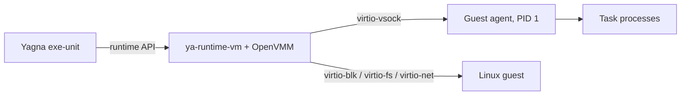

# ya-runtime-vm

[](https://github.com/golemfactory/ya-runtime-vm/actions/workflows/build.yml)
[](https://github.com/golemfactory/ya-runtime-vm/releases)
[](LICENSE)

A virtual machine runtime that lets [Golem Network](https://www.golem.network/)
providers run Linux task images in isolated VMs.

- **One self-contained executable:** [OpenVMM](https://github.com/microsoft/openvmm)
  is embedded, so no QEMU, firmware or separate VMM is installed.
- **Linux and Windows hosts:** KVM on Linux, Windows Hypervisor Platform (WHP)
  on Windows, running x86_64 Linux guests.
- **Golem tasks:** GVMI images, stdout/stderr streaming, host directory shares,
  storage and RAM volumes, Yagna VPN and INET networking.

## Supported platforms

| Host | Hypervisor | VM tests in CI | PCI passthrough |
| --- | --- | --- | --- |
| Linux x86_64 | KVM | Yes | Yes (VFIO) |
| Windows x86_64 | WHP | Manual ([procedure](docs/windows-whp-test.md)) | No |

## Install

Download a package from [GitHub Releases](https://github.com/golemfactory/ya-runtime-vm/releases).

On Debian or Ubuntu, install the `.deb`; it places the runtime under
`/usr/lib/yagna/plugins/`:

```sh
sudo apt install ./ya-runtime-vm_*_amd64.deb
```

Otherwise, extract the Linux `.tar.gz` or Windows `.zip` and copy
`ya-runtime-vm.json` and the `ya-runtime-vm/` directory into the provider's
plugin directory. The provider uses the first of `plugins/` beside its
executable, `~/.local/lib/yagna/plugins/` (a `golemsp` installation) and
`/usr/lib/yagna/plugins/`; `EXE_UNIT_PATH` overrides this. Keep the executable
and its `runtime/` directory together.

The host needs hardware virtualization:

- **Linux:** read/write access to `/dev/kvm`, usually through the `kvm` group.
- **Windows:** the Windows Hypervisor Platform feature, then a reboot:
  `Enable-WindowsOptionalFeature -Online -FeatureName HypervisorPlatform`.

Check the installation with the self-test, which boots a VM, runs a bundled
task and prints its JSON result:

```sh
./ya-runtime-vm test
```

## How it works

The exe-unit drives the runtime through the Yagna runtime API. The runtime boots
the Linux kernel directly and controls a Rust guest agent, running as PID 1,
over virtio-vsock. See [Architecture](docs/architecture.md) for details.



## Build from source

Install [mise](https://mise.jdx.dev/) for the pinned toolchain. On a Linux host
with Docker and `build-essential perl musl-tools`:

```sh
mise trust && mise install
mise run build-release
mise run guest-image
mise run fetch-self-test
mise run package
```

Packages are written to `releases/`. Windows builds, Debian packages and
requirements are covered in [Building and packaging](docs/building.md).

## Documentation

- [Building and packaging](docs/building.md)
- [Architecture](docs/architecture.md): guest agent, process lifecycle, repository layout
- [Volumes and host directories](docs/host-directories.md): share policy and limits
- [Networking](docs/networking.md): VPN and INET interfaces and their MTUs
- [Testing and troubleshooting](docs/testing.md)
- [Windows/WHP test procedure](docs/windows-whp-test.md)
- [virtio-fs security review](docs/virtiofs-security-review.md)

## Security

Report vulnerabilities privately through
[GitHub security advisories](https://github.com/golemfactory/ya-runtime-vm/security/advisories/new),
not in public issues.

## License

See [LICENSE](LICENSE). Release packages also include the MIT license of the
embedded OpenVMM code.
